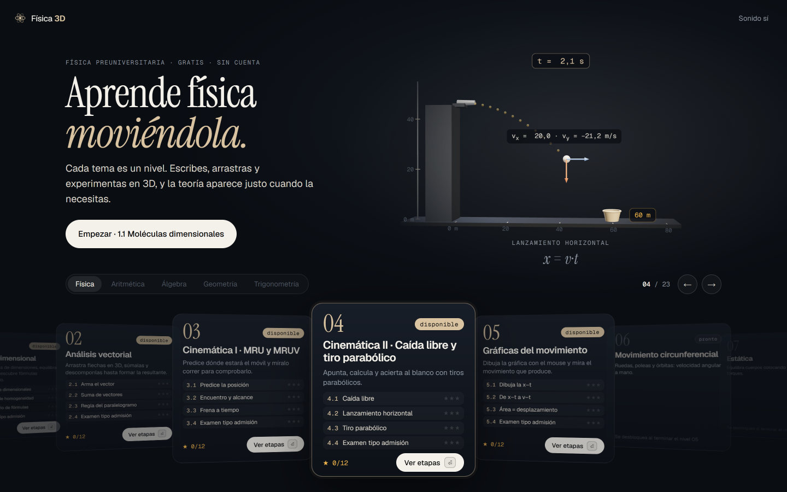
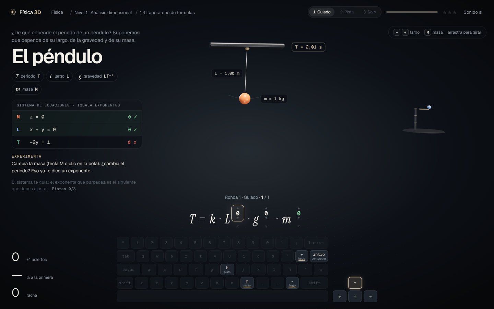
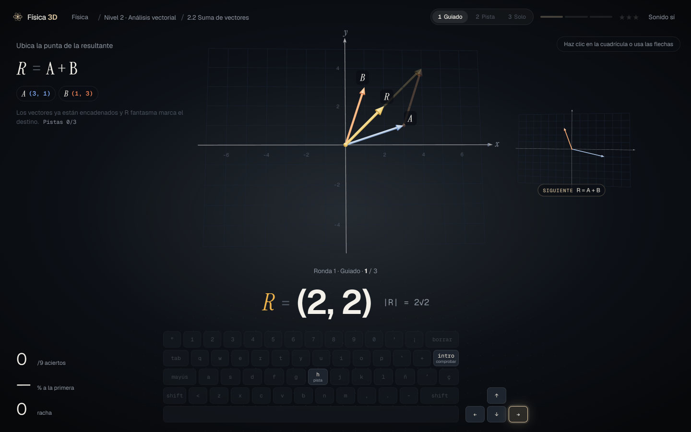
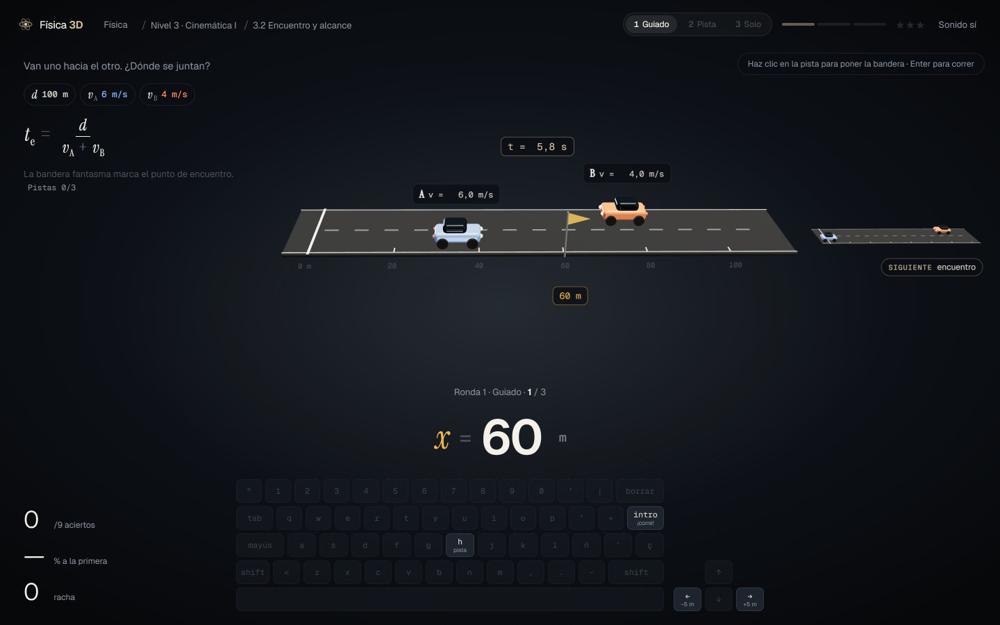
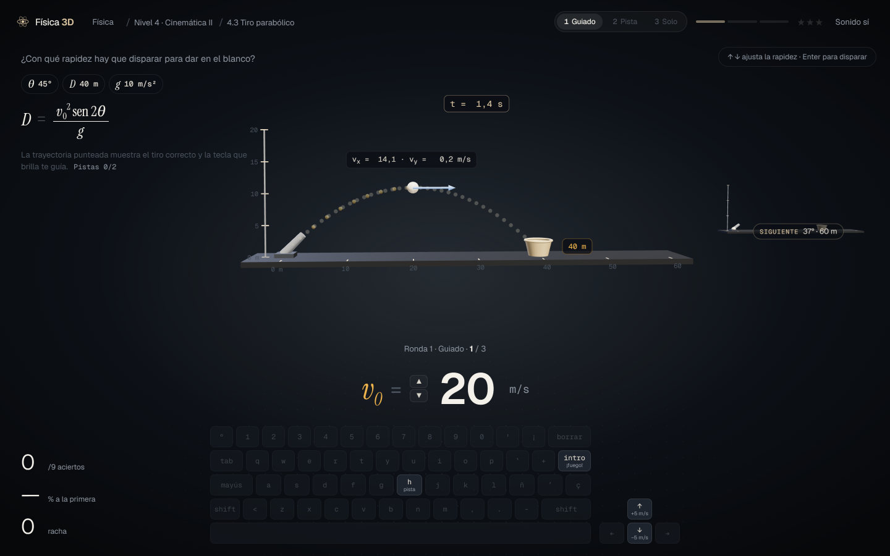
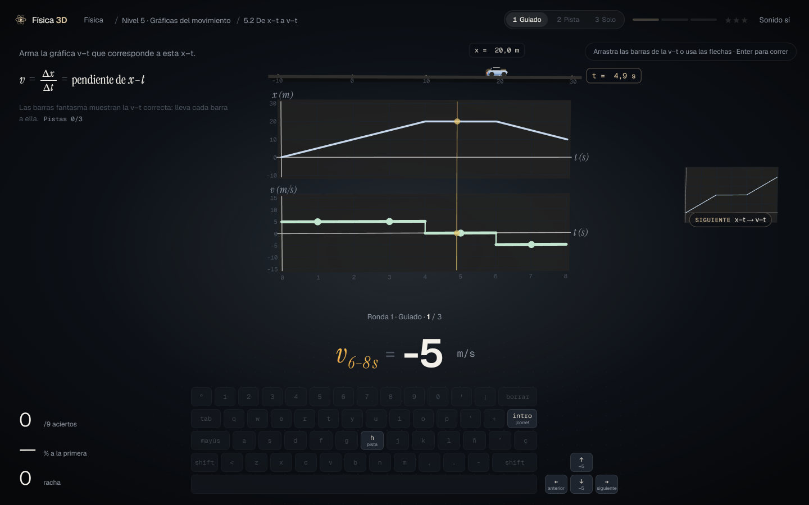
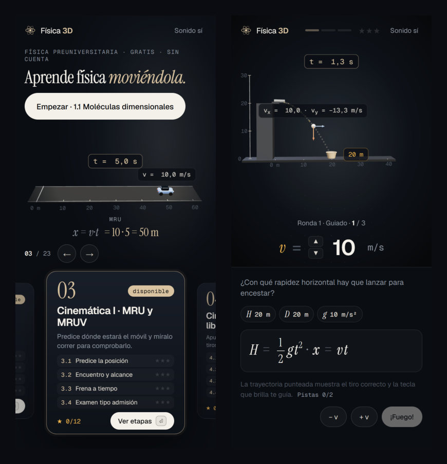
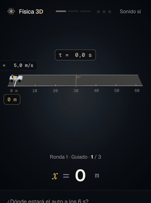

<div align="center">

# Learn Three

**Aprende haciendo.** Física y matemáticas preuniversitarias por niveles, con escenas 3D interactivas que se manejan con el teclado y el mouse.

[](https://github.com/MILLERMARRU/learn-three/actions/workflows/ci.yml)
[](https://react.dev)
[](https://vite.dev)
[](https://www.typescriptlang.org)
[](https://threejs.org)
[](https://r3f.docs.pmnd.rs)
[](#despliegue)
[](LICENSE)
[](CONTRIBUTING.md)

[Contribuir](CONTRIBUTING.md) · [Issues](https://github.com/MILLERMARRU/learn-three/issues) · [Para empezar](https://github.com/MILLERMARRU/learn-three/issues?q=is%3Aopen+label%3A%22good+first+issue%22) · [Hoja de ruta](#hoja-de-ruta)

<br/>



</div>

---

## Contenido

- [¿Qué es?](#qué-es)
- [Cursos](#cursos)
- [Física: niveles disponibles](#física-niveles-disponibles)
- [Capturas](#capturas)
- [Inicio rápido](#inicio-rápido)
- [Arquitectura](#arquitectura)
- [Añadir un nivel o un curso](#añadir-un-nivel-o-un-curso)
- [Responsive](#responsive)
- [Despliegue](#despliegue)
- [Hoja de ruta](#hoja-de-ruta)
- [Contribuir](#contribuir)
- [Contenido y derechos](#contenido-y-derechos)
- [Licencia](#licencia)

## ¿Qué es?

Learn Three es una plataforma web gratuita y sin cuenta para aprender ciencias y matemáticas de nivel preuniversitario **haciendo**, no leyendo. Se organiza en **cursos**. Cada tema de un curso es un **nivel**, y cada nivel tiene cuatro **etapas**: tres prácticas y un examen tipo admisión.

El primer curso es **Física**, con 5 de sus 23 niveles listos. Después vienen **Aritmética, Álgebra, Geometría y Trigonometría**, construidos con la misma plantilla.

En el curso de Física, en lugar de resolver ejercicios en papel, el estudiante:

- **predice** dónde estará un auto y lo ve correr;
- **ajusta** la rapidez de un cañón hasta encestar;
- **dibuja** una gráfica x–t y ve cómo el auto la obedece.

Si falla, la simulación le muestra exactamente qué pasó.

**Principios de diseño:**

- **Aprender con las manos.** Cada respuesta se comprueba con una simulación, no con un «correcto/incorrecto» seco.
- **Andamiaje en tres rondas.** *Guiado* (con fantasma y tecla resaltada) → *Pista* (con la fórmula) → *Solo*. Las pistas restan estrellas.
- **Ligero.** Solo `react`, `three` y `@react-three/fiber`. Las fórmulas, las etiquetas 3D y el router son componentes propios.
- **Contenido propio.** Los libros sirven como temario; todos los problemas son originales.

## Cursos

| Curso | Estado | Ideas de interacción |
|---|---|---|
| **Física** | Disponible · niveles 1–5 de 23 | Vectores, pistas con autos, tiros parabólicos y gráficas del movimiento en 3D |
| **Aritmética** | Planificado | Recta numérica, fracciones como piezas, proporciones con balanzas |
| **Álgebra** | Planificado | Balanza de ecuaciones, funciones cuya gráfica se deforma al cambiar parámetros |
| **Geometría** | Planificado | Sólidos que se arman y se cortan en 3D, áreas y volúmenes |
| **Trigonometría** | Planificado | Círculo unitario interactivo, ángulos notables, funciones y ondas |

El inicio ya muestra las pestañas de los cinco cursos. Cada uno reutilizará el mismo motor de etapas, el HUD, el carrusel 3D y el examen.

## Física: niveles disponibles

| Nivel | Tema | Etapas |
|:-:|---|---|
| 1 | Análisis dimensional | Moléculas dimensionales · Balanza de homogeneidad · Laboratorio de fórmulas · Examen |
| 2 | Análisis vectorial | Arma el vector · Suma de vectores · Regla del paralelogramo · Examen |
| 3 | Cinemática I · MRU y MRUV | Predice la posición · Encuentro y alcance · Frena a tiempo · Examen |
| 4 | Cinemática II · Caída libre y tiro parabólico | Caída libre · Lanzamiento horizontal · Tiro parabólico · Examen |
| 5 | Gráficas del movimiento | Dibuja la x–t · De x–t a v–t · Área = desplazamiento · Examen |
| 6 | Movimiento circunferencial | Velocidad angular · Poleas y engranajes · Aceleración centrípeta · Examen |
| 7 | Estática | Primera condición de equilibrio · Poleas fijas y móviles · Momento de una fuerza · Examen |
| 8 | Dinámica | Segunda ley de Newton · Plano inclinado con rozamiento · Sistemas de bloques · Examen |
| 9 | Gravitación universal | Ley de gravitación universal · Gravedad en la altura y en otros planetas · Satélites y leyes de Kepler · Examen |
| 10 | Trabajo, energía y potencia | Trabajo y energía cinética · Conservación de la energía mecánica · Potencia · Examen |

<details>
<summary><b>Detalle de las mecánicas por nivel</b></summary>

| Etapa | Mecánica | Cómo se evalúa |
|---|---|---|
| 1.1 Moléculas dimensionales | Escribir la ecuación dimensional; la molécula se arma en 3D | Dimensión exacta |
| 1.2 Balanza de homogeneidad | Escribir la dimensión de la incógnita hasta nivelar la balanza | El término iguala al de referencia |
| 1.3 Laboratorio de fórmulas | Ajustar exponentes mientras se experimenta (péndulo, caída, circular, onda) | Sistema de ecuaciones por base |
| 2.1 Arma el vector | Colocar la punta en la cuadrícula (clic, arrastre o flechas) | Punto exacto |
| 2.2 Suma de vectores | Ubicar la resultante con el método del polígono | Punto exacto |
| 2.3 Regla del paralelogramo | Escribir el módulo de R (ley de cosenos) | Valor con tolerancia |
| 3.1 Predice la posición | Poner la bandera y ver correr el auto (MRU) | El auto se detiene en la bandera |
| 3.2 Encuentro y alcance | Bandera donde se juntan dos autos | Punto exacto |
| 3.3 Frena a tiempo | Ajustar la aceleración (MRUV) | La simulación lo comprueba |
| 4.1 Caída libre | Marca de altura; la pelota se suelta, sube o baja | Llega a la marca |
| 4.2 Lanzamiento horizontal | Rapidez del cañón desde el acantilado | Cae en la canasta |
| 4.3 Tiro parabólico | Rapidez (ángulo fijo) o ángulo (30°–60°) | Da en el blanco (37° y 53° valen si igualan el alcance) |
| 5.1 Dibuja la x–t | Arrastrar los puntos según el enunciado | El auto coincide con el fantasma |
| 5.2 De x–t a v–t | Barras de velocidad por tramo (pendiente) | Cada barra = pendiente |
| 5.3 Área = desplazamiento | Calcular Δx; el área se pinta al correr | Área con signo |
| 6.1 Velocidad angular | Ajustar ω (en pasos de π/4) para que la marca de la rueda llegue a la meta | θ = ωt; la estela en espiral cuenta las vueltas |
| 6.2 Poleas y engranajes | Ajustar la ω de la última rueda (faja, engranajes, mismo eje, trenes de 4 ruedas) | La faja no patina y los dientes no chocan |
| 6.3 Aceleración centrípeta | Rapidez máxima para tomar la curva | Si v²/R supera a máx, el auto se sale por fuera |
| 7.1 Primera condición de equilibrio | Ajustar la fuerza que falta (colgado, piso, plano, dos cuerdas) | Si ΣF ≠ 0 el cuerpo se mueve; el polígono de fuerzas cierra |
| 7.2 Poleas fijas y móviles | Fuerza para sostener un peso con un aparejo potencial | La carga sube o baja; F = W/2ⁿ |
| 7.3 Momento de una fuerza | Ajustar una fuerza o un brazo en un balancín | La barra gira si ΣM ≠ 0 |
| 8.1 Segunda ley de Newton | Fuerza para que el bloque llegue a la bandera en t segundos (con rozamiento en «solo») | El bloque llega justo a tiempo |
| 8.2 Plano inclinado con rozamiento | Predecir la aceleración del bloque que baja | Un fantasma con la aceleración propuesta corre junto al real |
| 8.3 Sistemas de bloques | Aceleración (Atwood, mesa con pesa colgante) y tensión | Fantasmas junto al sistema; dinamómetro para la tensión |
| 9.1 Ley de gravitación universal | Nueva fuerza de atracción cuando cambian las masas o la distancia | Las flechas reales crecen junto a las propuestas |
| 9.2 Gravedad en la altura y en otros planetas | Predecir g a una altura o en otro planeta | Una bola fantasma cae junto a la real en el tubo de caída |
| 9.3 Satélites y leyes de Kepler | Período (T² ∝ r³) y velocidad orbital | Un satélite fantasma gira junto al real |
| 10.1 Trabajo y energía cinética | Rapidez de salida tras el empujón (W neto = ΔEc) | Un bloque fantasma corre junto al real |
| 10.2 Conservación de la energía mecánica | Rapidez en un punto o altura máxima en una pista lisa | Carrito fantasma o bandera; barras de Ec y Ep |
| 10.3 Potencia | Potencia de la grúa (P = mgh/t), con rendimiento | La carga llega justo a tiempo a la bandera |
| N.4 Examen tipo admisión | 10 preguntas, 45 s cada una; la escena se reproduce en 3D | Una sola oportunidad |

</details>

## Capturas

<table>
  <tr>
    <td width="50%"><br/><sub><b>Nivel 1 · Laboratorio de fórmulas.</b> El péndulo responde a − + y M mientras se ajustan los exponentes.</sub></td>
    <td width="50%"><br/><sub><b>Nivel 2 · Suma de vectores.</b> Método del polígono sobre un plano cartesiano 3D.</sub></td>
  </tr>
  <tr>
    <td><br/><sub><b>Nivel 3 · Encuentro y alcance.</b> Dos autos corren hacia la bandera del estudiante.</sub></td>
    <td><br/><sub><b>Nivel 4 · Tiro parabólico.</b> Estela estroboscópica y flechas de vₓ y v_y.</sub></td>
  </tr>
  <tr>
    <td><br/><sub><b>Nivel 5 · De x–t a v–t.</b> Un cursor recorre ambas gráficas mientras el auto avanza.</sub></td>
    <td align="center"><br/><sub><b>Móvil.</b> Inicio con el 3D del nivel y etapa con el enunciado debajo.</sub></td>
  </tr>
</table>

## Inicio rápido

**Requisitos:** Node.js 22.12 o superior (recomendado: 24) y npm.

```bash
git clone https://github.com/MILLERMARRU/learn-three.git
cd learn-three
npm ci
npm run dev        # http://localhost:5173
```

| Script | Qué hace |
|---|---|
| `npm run dev` | Servidor de desarrollo con recarga en caliente |
| `npm run build` | Verifica tipos (`tsc -b`) y genera `dist/` |
| `npm run preview` | Sirve el build de producción en local |
| `npm run lint` | Revisa el código con oxlint (falla con cualquier aviso) |
| `npm test` | Ejecuta las pruebas de la física (`tests/`) con el runner nativo de Node |

Las rutas usan hash: `#/nivel/{n}/{etapa}`. Por ejemplo, `#/nivel/4/parabolico`.

## Arquitectura

```
src/
├── motor/          Motor de etapas: rondas, pistas, puntos, estrellas y entradas por teclado
├── ui/             HUD común (CascaronEtapa), teclado virtual, fórmulas sin KaTeX
├── three/          Escenario (canvas, luces, encuadre), carrusel 3D, etiquetas HTML ancladas
│   ├── vectores/   Plano cartesiano y flechas (nivel 2)
│   ├── pista/      Pista con autos, MRU/MRUV (nivel 3)
│   ├── tiro/       Torre, cañón, canasta, estela y flechas de velocidad (nivel 4)
│   └── grafica/    Paneles x–t / v–t editables con área y auto (nivel 5)
├── lib/            Física y utilidades puras: dimensiones, vectores, tiros, gráficas, sonido
├── contenido/      El contenido como datos: nivel-0N/*.tsx (problemas propios) y curso.ts (hoy, el curso de Física)
├── etapas/         Una etapa = contenido + escena + panel; Examen.tsx es genérico
└── paginas/        Inicio sin scroll: hero 3D por nivel y carrusel de niveles → etapas
tests/              Pruebas de src/lib con node:test (sin dependencias)
```

**Cómo se arma una etapa:**

1. `contenido/nivel-0N/` define los ejercicios de cada ronda como datos (`RondaDef<T>[]`).
2. `useEtapa()` (en `motor/etapa.ts`) lleva el estado: ronda, ítem, pistas, aciertos, estrellas y progreso en `localStorage`.
3. `<CascaronEtapa>` pinta el HUD: cabecera, enunciado flotante, respuesta central, teclado virtual y transiciones.
4. `<CarruselItems>` muestra el ejercicio actual en 3D y el siguiente esperando a la derecha.
5. La escena 3D simula y, al terminar, la etapa evalúa con `motor.acierto()` o `motor.error()`.

## Añadir un nivel o un curso

1. **Contenido:** crear `src/contenido/nivel-0N/*.tsx` con los ítems de cada ronda y el examen (problemas propios, con números que den resultados exactos).
2. **Escena 3D:** crear la escena en `src/three/<tema>/`, solo con primitivas de three.js y con un modo `previa` para el carrusel.
3. **Etapas:** crear `src/etapas/nivel-0N/` con `useEtapa()` + `<CascaronEtapa>` + `<CarruselItems>`; el examen usa `<Examen>`.
4. **Registro:** rutas en `src/App.tsx` con `lazy(() => import(...))`, para que cada etapa se descargue solo al entrar; etapas en `ETAPAS_POR_NIVEL` de `src/contenido/curso.ts` e ilustraciones en `VisualEtapa` de `src/paginas/Mapa.tsx`.
5. **Hero:** agregar el hero del nivel en `src/paginas/hero/` y registrarlo en `HeroNivel.tsx`.

**Un curso nuevo** (por ejemplo, Álgebra) reutiliza el mismo motor, HUD, carrusel y examen. Se propone primero en un issue, con la plantilla «Propuesta de nivel o etapa», para acordar la estructura de carpetas (`contenido/<curso>/`, `etapas/<curso>/`) y la navegación del inicio.

La guía completa, con convenciones y checklist, está en [CONTRIBUTING.md](CONTRIBUTING.md).

## Responsive

| Pantalla | Comportamiento |
|---|---|
| Móvil vertical / tablet | Escena arriba y enunciado debajo; en el inicio, el 3D del nivel aparece apilado si hay altura |
| Móvil horizontal | Escena a la izquierda y enunciado a la derecha con scroll propio |
| Escritorio ≤ 1400 px | La escena empieza a la derecha del enunciado; el ejercicio siguiente se oculta si no cabe |
| Laptops bajas | Teclado y respuesta compactos |
| 2K / 4K | La interfaz HTML escala con `zoom`; el canvas 3D se adapta solo |
| Pantallas táctiles | Los objetos se arrastran con el dedo sin desplazar la página; botones y flechas de al menos 44 px |

<p align="center"></p>

## Despliegue

El repo incluye un `Dockerfile` multi-etapa (Node compila con Vite y nginx sirve `dist/`) y un `nginx.conf` con gzip, caché larga para `/assets/` y chequeo de salud en `/salud`.

```bash
docker build -t learn-three .
docker run --rm -p 8080:80 learn-three   # http://localhost:8080
```

**Dokploy:**

1. Crear una aplicación con proveedor GitHub, repo `learn-three`, rama `main`.
2. Configurar **Build Type** `Dockerfile` · **Dockerfile Path** `Dockerfile` · **Context** `.`.
3. Asignar un dominio con **Container Port** `80`.

No necesita variables de entorno.

## Hoja de ruta

**Física**

- [x] Niveles 1–10: dimensional, vectorial, cinemática I y II, gráficas, movimiento circunferencial, estática, dinámica, gravitación universal y trabajo, energía y potencia.
- [ ] Niveles 11–23: choques, MAS, ondas, hidrostática, calor, termodinámica, electricidad, magnetismo, óptica y física moderna.

**Matemáticas**

- [ ] Curso de Álgebra.
- [ ] Curso de Aritmética.
- [ ] Curso de Geometría.
- [ ] Curso de Trigonometría.

**Plataforma**

- [x] CI con verificación de tipos, lint, build e imagen Docker en cada PR.
- [x] Carga diferida por etapa y librerías (React, React Three Fiber, three.js) en chunks propios.

Las tareas abiertas están en [Issues](https://github.com/MILLERMARRU/learn-three/issues). Las marcadas con [`good first issue`](https://github.com/MILLERMARRU/learn-three/issues?q=is%3Aopen+label%3A%22good+first+issue%22) son ideales para empezar.

## Contribuir

Este es un proyecto colaborativo y **toda ayuda suma**: código, niveles y cursos nuevos, escenas 3D, revisión de contenido de física y matemáticas, pruebas en dispositivos y documentación.

1. Lee la [guía de contribución](CONTRIBUTING.md) y el [issue de bienvenida](https://github.com/MILLERMARRU/learn-three/issues/14).
2. Elige un issue y comenta que lo tomas.
3. Trabaja en tu **fork** y abre un **pull request** hacia `main`.

## Contenido y derechos

- Los libros de referencia se usan **solo como temario** y para calibrar la dificultad. Los enunciados, las escenas y las explicaciones son **originales**.
- No se suben ni se copian textos ni PDFs de terceros.

## Licencia

El código se publica bajo la **[licencia MIT](LICENSE)**. En resumen, puedes:

- usarlo, copiarlo, modificarlo y distribuirlo, incluso con fines comerciales;
- integrarlo en otros proyectos.

La única condición es conservar el aviso de copyright y el texto de la licencia. El software se entrega «tal cual», sin garantías.

Al enviar un pull request aceptas que tu contribución se publique bajo esta misma licencia.

---

<div align="center">
<sub>Creado por <a href="https://github.com/MILLERMARRU">Miller</a> · Hecho con React, three.js y muchas ganas de que la física y las matemáticas se entiendan.</sub>
</div>
